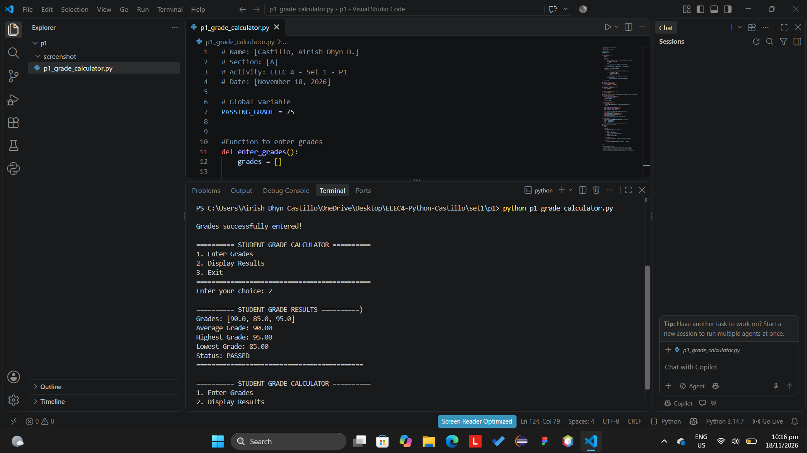

# ELEC4 - Python Programming

**Name:** Airish Dhyn D. Castillo  
**Section:** A 
**Course:** ELEC4 - Python Programming

## Set 1 Activities

### P1 - Grade Calculator

**Description:** A Python program that calculates student grades.

**Folder:** [P1 - Grade Calculator](set1/p1)

**Run Command:**
```bash
python set1/p1/p1_grade_calculator.py
```

**Screenshot:**



### P2
To be added.

### P3
To be added.

### P4
To be added.
