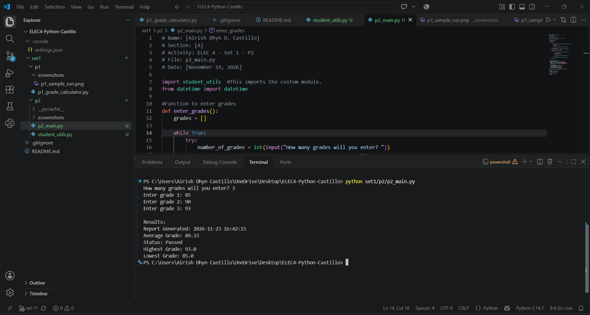

# ELEC4 - Python Programming

**Name:** Airish Dhyn D. Castillo  
**Section:** A 
**Course:** ELEC4 - Python Programming

## Set 1 Activities

### P1 - Grade Calculator

**Description:** A Python program that calculates student grades.

**Folder:** [P1 - Grade Calculator](set1/p1)

**Run Command:**
```bash
python set1/p1/p1_grade_calculator.py
```

**Screenshot:**


### P2 - Custom Module: student_utils

Created a custom Python module named `student_utils.py` containing reusable functions for calculating grades. The main program imports and uses the custom module along with a built-in Python module.

**Run:**

```bash
python set1/p2/p2_main.py

**Screenshot:**



### P3
To be added.

### P4
To be added.
